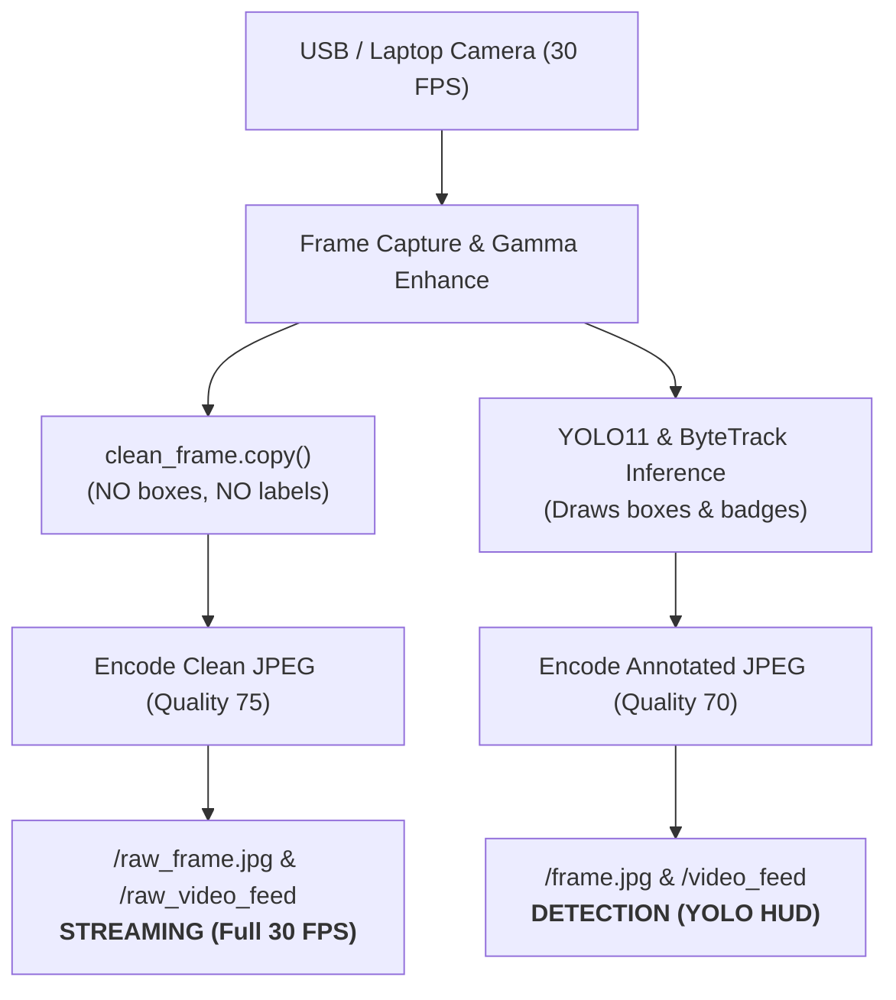

# 🐔 PoultrySense — Team Update & Feature Changelog

**Branch:** `updated-geminiai-and-sms-notification`  
**Latest Commits:** `dab1cb9` ➔ `0ea3fe0` ➔ `65fbb1c`  
**Target Audience:** PoultrySense Engineering & Farm Operations Team  

---

## 📌 Executive Summary

This update introduces major architectural improvements to PoultrySense:
1. **Multimodal Gemini AI Diagnostics:** Automated visual-and-sensor diagnostic verdicts using Gemini 3.6 Flash via the official `google-genai` SDK.
2. **Synchronized 15-Minute Alert Cooldown:** Global 900-second cooldown eliminating duplicate SMS notifications and API quota exhaustion caused by ByteTrack ID switches.
3. **Decoupled Video Pipeline (Streaming vs. Detection):** Separated the camera feed into a dedicated ultra-smooth 30 FPS raw camera stream and an AI-annotated detection feed.
4. **1-Tap UI Toggle in Android App:** Real-time switch on the flock monitor allowing farmers to switch seamlessly between **Streaming** (clean view) and **Detection** (YOLO bounding boxes).

---

## 🏗️ Architecture & Detailed Feature Breakdown

### 1. 🤖 Multimodal Gemini 3.6 Flash Integration

When any chicken exhibits abnormal behavior or environmental stress:
* **Trigger Conditions:**
  * Prolonged immobility / recumbency (stationary $>45$s during daytime).
  * Lethargic posture or abnormal movement.
  * Spatial flock isolation.
  * Thermal stress (ambient temp $>30^\circ\text{C}$ or $<18^\circ\text{C}$ from ESP32 DHT22).
  * High anomaly score tier (`Suspicious` or `Alert`).
* **Visual Snapshot Crop:** The AI engine automatically crops the bounding box of the flagged chicken and saves it as `flagged_chicken.jpg`.
* **Multimodal Query:** Sends both the cropped image + live sensor telemetry (temperature, humidity, stationary duration, gait history) to Gemini.
* **Strict Pydantic Schema Enforcement:**
  ```python
  class ChickenDiagnosticVerdict(BaseModel):
      severity: Literal["Low", "Medium", "High", "Critical"]
      reason: str
      farmer_action: str
  ```
* **Real-time Sync:** Verdicts are automatically pushed to Firebase Realtime Database (`/active_alerts` and `/diagnostic_verdicts`).

---

### 2. ⏱️ Unified 15-Minute (900s) Global Alert Cooldown

#### The Problem:
In computer vision, when a chicken walks behind another bird or briefly exits the camera frame, multi-object tracking (ByteTrack) may assign a new tracking ID upon return. Previously, this caused repetitive Gemini API calls and spammy Twilio SMS alerts.

#### The Solution:
* Enforced a unified **15-minute (`900.0` seconds)** timestamp-based global cooldown (`GLOBAL_ALERT_COOLDOWN_SEC = 900.0`).
* Applies across both **Gemini queries** and **Twilio SMS dispatches**.
* Wrapped in thread-safe locks (`_global_cooldown_lock`) with graceful `try-except` error handling.
* Telemetry status endpoint (`/status`) broadcasts cooldown state (`global_cooldown_active`, `global_cooldown_remaining_sec`).

---

### 3. ⚡ Decoupled Streaming vs. Detection Pipeline

#### The Bottleneck Solved:
Previously, camera capture, YOLO detection, box drawing, and JPEG encoding ran sequentially in a single loop. Because the AI inference and OpenCV pixel drawing took 50–70ms, the camera stream dropped to 12–15 FPS, causing video lag and visual clutter.

#### The New Two-Stream Architecture:



#### New Server Endpoints:
| Endpoint | Mode | Content | Target FPS |
|---|---|---|---|
| `GET /raw_frame.jpg` | **Streaming** | Pure camera photo (no boxes, no text) | 30 FPS |
| `GET /raw_video_feed` | **Streaming** | Clean multipart MJPEG stream | 30 FPS |
| `GET /frame.jpg` | **Detection** | YOLO bounding boxes, IDs, health badges | ~15–20 FPS |
| `GET /video_feed` | **Detection** | Annotated multipart MJPEG stream | ~15–20 FPS |
| `GET /frame.jpg?mode=raw` | Parameterized | Backward-compatible parameter support | 30 FPS |

---

### 4. 📱 Android UI & Reactive Feed Switch

#### UI Additions (`fragment_monitor.xml`):
* Added a segmented pill selector above the video viewport:
  * **`📹 Streaming`**: Switches to the clean, high-FPS video stream without any boxes.
  * **`🎯 Detection`**: Switches to the annotated AI feed with real-time bounding boxes.
* Added custom drawables:
  * `@drawable/bg_segmented_container`: Subtle rounded background container.
  * `@drawable/bg_segmented_active`: Elevated active white pill indicator.
* Enhanced HUD Pill inside the video view:
  * Displays **`STREAMING`** with an accent green pulse dot in streaming mode.
  * Displays **`DETECTION`** with a cyan pulse dot in detection mode.

#### Mobile Controller (`MonitorFragment.kt`):
* Added `enum class VideoFeedMode { STREAMING, DETECTION }`.
* Tapping either toggle or tapping the video HUD pill directly:
  1. Plays system haptic click feedback (`HapticFeedbackConstants.VIRTUAL_KEY`).
  2. Updates visual highlight states on the toggle buttons.
  3. Seamlessly restarts frame polling (`/raw_frame.jpg` vs `/frame.jpg`) with zero latency.

---

### 5. 🌐 Web Dashboard Updates (`http://localhost:5000/`)

* Added **`📹 Streaming Feed`** and **`📺 Detection Feed`** direct stream buttons.
* Added a live toggle button (**`Switch to Streaming`** / **`Switch to Detection`**) that switches the displayed MJPEG video in real-time.

---

## 🧪 How Team Members Can Test This Branch

### Step 1: Checkout the branch
```bash
git fetch origin
git checkout updated-geminiai-and-sms-notification
git pull origin updated-geminiai-and-sms-notification
```

### Step 2: Start the AI Server
```bash
# Ensure your virtual environment is active
cd poultrysense_ai
python poultrysense_ai.py
```
* Open `http://localhost:5000` in your web browser.
* Click **"Switch to Streaming"** to verify the clean camera feed (no boxes).
* Click **"Switch to Detection"** to verify the YOLO bounding boxes.

### Step 3: Run the Android App in Android Studio
1. Open the project in **Android Studio**.
2. Run on your physical Android device or emulator.
3. Navigate to the **Monitor** screen:
   * By default, the feed launches in **Streaming** mode (crisp, smooth 30 FPS video).
   * Tap **`🎯 Detection`** ➔ Observe YOLO bounding boxes, health status badges, and tracking IDs appear.
   * Tap **`📹 Streaming`** ➔ Observe the boxes instantly disappear and frame rate increase to full 30 FPS.
   * Tap the **`STREAMING` / `DETECTION`** glass badge inside the video viewport to toggle between modes directly.

---

## 📂 Key Files Modified in this Update

* `poultrysense_ai/poultrysense_ai.py` — Decoupled raw vs annotated frame encoding, Gemini 3.6 Flash multimodal diagnostic logic, 15-min cooldown, new streaming endpoints.
* `poultrysense_ai/gemini_config.json.example` — Configuration template for Gemini API key and cooldown settings.
* `app/src/main/res/layout/fragment_monitor.xml` — Added segmented toggle control header for Streaming vs Detection.
* `app/src/main/res/drawable/bg_segmented_container.xml` — Segmented control container background.
* `app/src/main/res/drawable/bg_segmented_active.xml` — Active segmented button background.
* `app/src/main/java/com/example/poultrysense/ui/monitor/MonitorFragment.kt` — Reactive feed mode state manager, dynamic endpoint switching, HUD status synchronization.

---
*Created for the PoultrySense Engineering Team. Questions or bug reports? Reach out on GitHub issues or team chat.*
